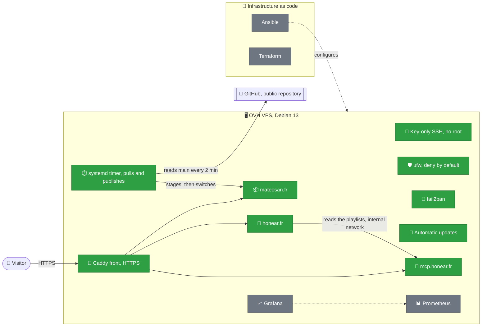

# 🏠 Homelab: a real server, hardened step by step

> 🇫🇷 The French version comes first: [README.md](README.md). This page is its English translation.

The log of an internet-facing VPS that I administer myself: every step written down with its decisions, its commands, its
pitfalls and its reasons. Today the server hosts my site, [mateosan.fr](https://mateosan.fr), my blind test game,
[honear.fr](https://honear.fr), and its MCP server, [mcp.honear.fr](https://mcp.honear.fr).

## The goal

To build, secure and grow a complete infrastructure, from a bare server up to container orchestration, with production
practices: least privilege, configuration described as code, monitoring, continuous deployment.

Nothing is simulated: the server is really online, really targeted by bots like any exposed server, and hardened in response
to what its logs show.

## The server today



🟢 Done · ⚪ Planned

The server was reinstalled on 12 October 2026 to host several sites: a shared Caddy front, the only thing listening on 80 and
443, and each site in its own container, on its own network. The details, with no secrets:
[`docs/architecture-actuelle.md`](docs/architecture-actuelle.md) (in French).

## The roadmap

### Phase 1: Linux hardening ✅ *July 2026*

- [x] Audit the configuration delivered by the hosting provider
- [x] Key-only SSH (one Ed25519 key), no password, and `root` forbidden over SSH
- [x] Firewall (`ufw`): everything denied inbound, except SSH, 80 and 443
- [x] `fail2ban`: progressive bans (doubled on each repeat offence, one week at most), verified in the kernel's rules. The
  `nftables` package was missing: no ban was actually applied. Found, then fixed
- [x] Automatic updates (`unattended-upgrades`), with a reboot at night when one is needed

### Phases 2 and 3: containers and HTTPS ✅ *July 2026*

- [x] Docker and Docker Compose
- [x] A domain name and its DNS
- [x] Caddy as a reverse proxy, with automatic HTTPS certificates (Let's Encrypt)

### Phase 4: continuous deployment ✅ *July 2026, redone in October*

- [x] Pull rather than push: a systemd timer reads the public repository every two minutes, instead of letting GitHub Actions
  connect over SSH. No inbound access, no deployment secret (the trade-off is documented)
- [x] A dedicated, unprivileged user stages each version next to the live one, then switches in one go; the last three are
  kept
- [x] The timer never runs a script that came from GitHub: its tools are installed once on the server
- [x] Tried by hand first, then proven in real conditions, in the logs

### One server for several sites ✅ *October 2026*

- [x] Reinstalled on 12 October: a shared Caddy front, containers on separate networks, no other published port
- [x] The showcase site moves to its own repository, [SNZMTO/mateosan.fr](https://github.com/SNZMTO/mateosan.fr), with its
  container and its timer
- [x] The [Honear](https://github.com/SNZMTO/honear) blind test and its [MCP server](https://github.com/SNZMTO/honear-mcp)
  run there too

### Next: backups 📌 *top priority*

- [ ] The Honear players' accounts (e-mail addresses and scores), then the certificates and the configuration. The procedure
  is ready, not installed yet: [`docs/sauvegardes.md`](docs/sauvegardes.md)

### Phase 5: monitoring 📌 *planned*

- [ ] Prometheus (metrics) and Grafana (dashboards)

### Phase 6: Ansible 📌 *planned*

- [ ] A server configuration that can be replayed entirely, from code

### Phase 7: Terraform 📌 *planned*

- [ ] The infrastructure described as code

### Phase 8: public cloud 📌 *optional*

- [ ] An extension on the AWS free tier

### Phase 9: orchestration 📌 *optional*

- [ ] k3s, a lightweight Kubernetes

## What protects the server today

| Measure | Status |
|---|---|
| Key-only SSH, for a single administration account; no password, no `root`; three attempts per connection | ✅ |
| The SSH configuration in a separate file, which `cloud-init` does not rewrite | ✅ |
| Firewall: everything denied inbound, except SSH, HTTP and HTTPS | ✅ |
| fail2ban on SSH | ✅ |
| Automatic updates for Debian and Docker, and a reboot at 5 a.m. when a new kernel requires it | ✅ |
| HTTPS with automatic certificates, for every domain, through a single front | ✅ |
| Only one container publishes ports, the front: Docker opens them without going through ufw | ✅ |
| Containers with no Linux capabilities, read-only, under an unprivileged user, each on its own network | ✅ |
| Pull-based deployment: no inbound access, no deployment secret | ✅ |
| Logs kept six months at most, without the visits | ✅ |
| Off-server backups | ⏳ procedure ready, not installed yet |

## The repository

```
homelab/
├── README.md                     # the French version of this file
├── docs/
│   ├── architecture-actuelle.md  # the server as it has been running since 12 October 2026
│   ├── sauvegardes.md            # backups of the players' accounts, and their restore test
│   └── …                         # one log per step from July: the audit, the decisions, the commands, the pitfalls
└── outils/                       # files ready to install on the server, not installed yet
    ├── agent/                    # putting Honear online, the only thing an AI agent does as root
    └── sauvegarde/               # restic, its service and its nightly timer
```

The showcase site and its deployment (its container, its Caddy, its systemd timer) live in
[SNZMTO/mateosan.fr](https://github.com/SNZMTO/mateosan.fr). The machine's configuration and the shared front live in a
private repository, because they give away the server's address.

## The tools

**In place:** `Debian 13` · `OpenSSH` · `ufw` · `fail2ban` · `nftables` · `unattended-upgrades` · `Docker` ·
`Docker Compose` · `Caddy` · `Let's Encrypt` · `systemd timers`

**Planned:** `Prometheus` · `Grafana` · `Ansible` · `Terraform` · `k3s`

## Where it comes from

This project goes alongside the 42 curriculum, whose system projects lay the foundations: Born2beRoot (a first hardened
server, in a virtual machine), Net_Practice (IP networking) and Inception (a Docker Compose stack). Here I apply them to a
real server exposed to the internet, and I go further, towards a complete and documented infrastructure.

## How I did it

In July, I carried out every step myself, over SSH from my PC, with an AI in a chat to explain the tools and their pitfalls:
the logs keep the trace of it, down to the Caddyfile damaged by a copy-paste from the chat. Since the October reinstall, the
machine's configuration is written as scripts with Claude Code, and its commits are co-signed.

---

*Each step has its log in `docs/` (in French): the exact commands, the pitfalls met and the reason for each choice.*
