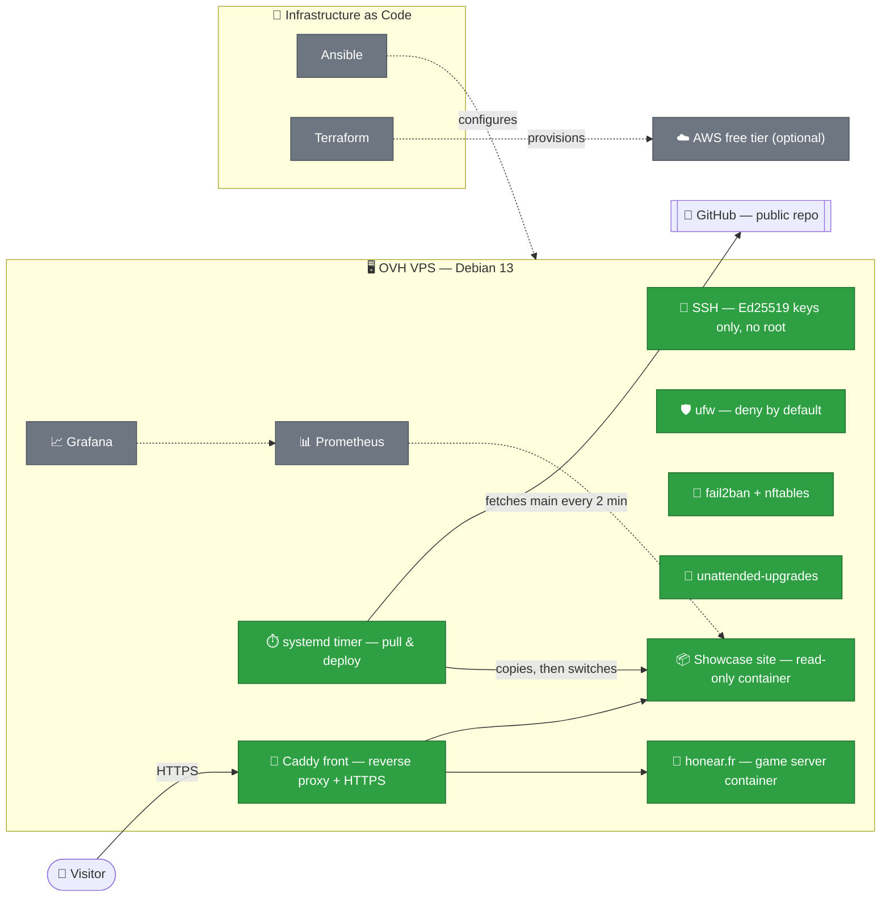

# 🏠 Homelab — Building Secure Infrastructure from Scratch

> A hands-on infrastructure/security/DevOps project built on a real, internet-facing VPS — not an isolated local VM. Every phase is documented with the decisions made, the mistakes hit along the way, and why they were fixed the way they were.

## 🎯 Project Goal

Design, secure, and evolve a complete infrastructure — from a bare server up to container orchestration — applying real production practices: least privilege, infrastructure as code, monitoring, CI/CD.

This repo serves both as a **technical training ground** and as **verifiable proof of skills**: nothing here is simulated. The server is genuinely online, genuinely targeted by bots like any exposed server, and genuinely hardened in response.

## 🗺️ Architecture



🟢 Done · ⚪ Planned

The same server also runs [honear](https://github.com/SNZMTO/honear), a multiplayer game, behind the shared Caddy front.

The showcase site itself, [mateosan.fr](https://mateosan.fr), lives in its own repository,
[SNZMTO/mateosan.fr](https://github.com/SNZMTO/mateosan.fr): its pages, its container and its timer. This repo keeps the
infrastructure log.

## 📋 Roadmap

### Phase 1 — Linux Hardening ✅ *done*
- [x] Audited the system configuration shipped by the hosting provider
- [x] SSH authentication restricted to Ed25519 key pairs only
- [x] `root` login fully disabled over SSH
- [x] Firewall (`ufw`): incoming traffic denied by default, only SSH, 80 and 443 open
- [x] `fail2ban`: progressive banning (doubled on each repeat offence, capped at one week), checked in the kernel's rule set — a missing `nftables` package meant bans were never actually applied, found and fixed
- [x] Automatic security updates (`unattended-upgrades`), with a reboot at 04:00 when one is needed

### Phase 2 — Containerization ✅ *done*
- [x] Docker & Docker Compose
- [x] First containerized service: the showcase site, served by Caddy

### Phase 3 — Secure Web Exposure ✅ *done*
- [x] Domain name + DNS
- [x] Caddy reverse proxy + automatic HTTPS certificates (Let's Encrypt)

### Phase 4 — Continuous Deployment ✅ *done*
- [x] Pull, not push: a systemd timer fetches the public repo every 2 minutes, instead of GitHub Actions connecting over SSH — no inbound access, no secret on the server (the trade-off is documented)
- [x] A dedicated unprivileged user puts each new version next to the live one, then switches atomically; the last three versions are kept
- [x] The timer never runs a script that comes from GitHub: its tools are installed on the server once
- [x] Tested by hand first, then proven in real conditions through the logs

### Next — Backups 📌
- [ ] Caddy certificates, `/etc` configuration, future data

### Phase 5 — Observability 📌 *planned*
- [ ] Prometheus (metrics) + Grafana (dashboards)

### Phase 6 — Ansible 📌 *planned*
- [ ] Fully reproducible server configuration, driven from code

### Phase 7 — Terraform 📌 *planned*
- [ ] Infrastructure provisioning as code

### Phase 8 — Public Cloud 📌 *optional*
- [ ] Extension to AWS free tier

### Phase 9 — Orchestration 📌 *optional*
- [ ] Lightweight k3s / Kubernetes

## 🛡️ Security Measures in Place

| Measure | Status |
|---|---|
| Key-only SSH authentication (Ed25519, no password login) | ✅ |
| `root` login disabled over SSH | ✅ |
| SSH config versioned and independent from auto-generated files (`cloud-init`) | ✅ |
| Firewall: deny by default, only SSH, 80 and 443 open | ✅ |
| fail2ban with progressive bans, enforced in the kernel (`nftables`) | ✅ |
| Automatic security updates | ✅ |
| HTTPS with automatic certificates | ✅ |
| Site container running as `nobody`, read-only, with no Linux capabilities and no published port | ✅ |
| Deployment by pull: no inbound access, no secret on the server | ✅ |
| Backups | ⏳ next |

## 📁 Repo Structure

```
homelab/
├── README.md        # this file
└── docs/            # one detailed log per phase: audit, decisions, commands, pitfalls
```

The showcase site and its deployment (container, Caddy, systemd timer) live in
[SNZMTO/mateosan.fr](https://github.com/SNZMTO/mateosan.fr); the machine-level configuration and the Caddy front shared with
honear, in a separate repository (`vps`).

## 🧰 Tech Stack

**In place:** `Debian 13` · `OpenSSH` · `ufw` · `fail2ban` · `nftables` · `unattended-upgrades` · `Docker` · `Docker Compose` · `Caddy` · `Let's Encrypt` · `systemd timers`

**Planned:** `Prometheus` · `Grafana` · `Ansible` · `Terraform` · `k3s`

## 📖 Background

This project runs alongside the 42 curriculum, whose system projects cover the basics: Born2beRoot (a first hardened server, in a VM), Net_Practice (IP networking) and Inception (a Docker Compose stack). The goal here is to apply them to a real server exposed to the internet, and to go further, toward a complete and fully documented infrastructure.

---

*Each phase has its own detailed log in `docs/` (in French), with exact commands, pitfalls encountered, and the reasoning behind every technical choice.*
