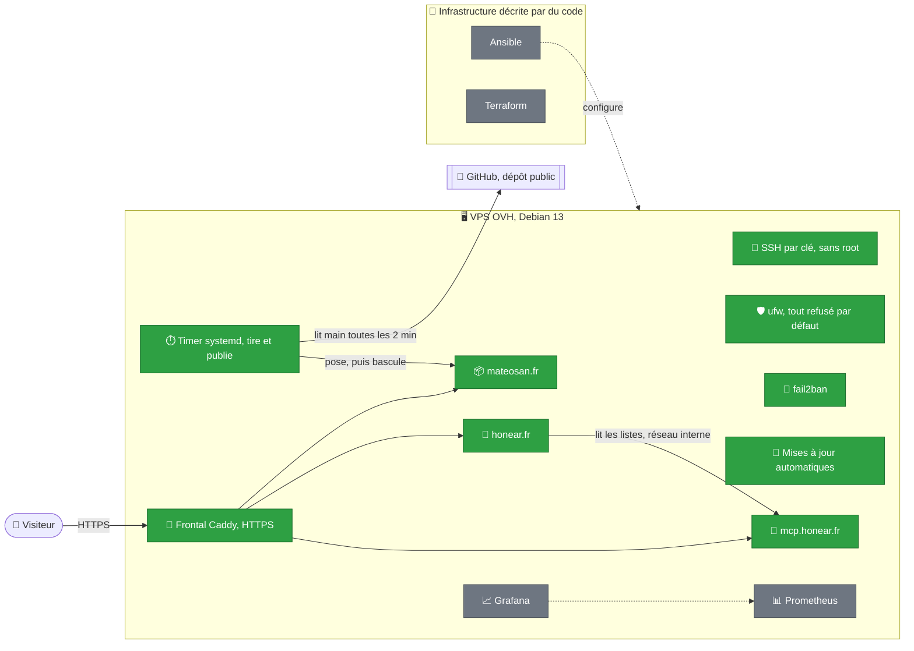

# 🏠 Homelab : un vrai serveur, durci pas à pas

Le journal d'un VPS exposé à internet, que j'administre moi-même : chaque étape notée avec ses décisions, ses commandes, ses
pièges et ses raisons. Le serveur héberge aujourd'hui mon site, [mateosan.fr](https://mateosan.fr), mon blind test,
[honear.fr](https://honear.fr), et son serveur MCP, [mcp.honear.fr](https://mcp.honear.fr).

> **In English.** The log of a real, internet-facing VPS that I run myself (OVH, Debian 13), hardened step by step: key-only
> SSH, a deny-by-default firewall, fail2ban, automatic updates, Docker containers behind a shared Caddy front with automatic
> HTTPS, and continuous deployment by pull, with no inbound access and no deployment secret. The July logs cover the first
> install; the server was reinstalled on 12 October 2026 to host several sites, and
> [`docs/architecture-actuelle.md`](docs/architecture-actuelle.md) describes it as it runs today. Docs are in French.

## Le but

Construire, sécuriser et faire grandir une infrastructure complète, d'un serveur nu jusqu'à l'orchestration de conteneurs, avec
les pratiques de la production : le moindre privilège, la configuration décrite par du code, la supervision, le déploiement
continu.

Rien n'est simulé : le serveur est vraiment en ligne, vraiment visé par des robots comme tout serveur exposé, et durci en
réponse à ce que montrent ses journaux.

## Le serveur aujourd'hui



🟢 Fait · ⚪ Prévu

Le serveur a été réinstallé le 12 octobre 2026 pour héberger plusieurs sites : un frontal Caddy partagé, seul à écouter 80 et
443, et chaque site dans son conteneur, sur son propre réseau. Le détail, sans secret :
[`docs/architecture-actuelle.md`](docs/architecture-actuelle.md).

## La feuille de route

### Phase 1 : le durcissement Linux ✅ *juillet 2026*

- [x] Auditer la configuration livrée par l'hébergeur
- [x] SSH par clé seulement (une clé Ed25519), sans mot de passe, et `root` interdit en SSH
- [x] Pare-feu (`ufw`) : tout refusé en entrée, sauf SSH, 80 et 443
- [x] `fail2ban` : des bannissements progressifs (doublés à chaque récidive, une semaine au plus), vérifiés dans les règles du
  noyau. Il manquait le paquet `nftables` : aucun bannissement ne s'appliquait. Trouvé, puis corrigé
- [x] Les mises à jour automatiques (`unattended-upgrades`), avec un redémarrage la nuit quand il le faut

### Phases 2 et 3 : les conteneurs et le HTTPS ✅ *juillet 2026*

- [x] Docker et Docker Compose
- [x] Un nom de domaine et ses DNS
- [x] Caddy en reverse proxy, avec des certificats HTTPS automatiques (Let's Encrypt)

### Phase 4 : le déploiement continu ✅ *juillet 2026, refait en octobre*

- [x] Tirer plutôt que pousser : un timer systemd lit le dépôt public toutes les deux minutes, au lieu de laisser GitHub Actions
  se connecter en SSH. Aucun accès entrant, aucun secret de déploiement (le compromis est documenté)
- [x] Un utilisateur dédié, sans droits, pose chaque version à côté de celle en ligne, puis bascule d'un coup ; les trois
  dernières restent
- [x] Le timer n'exécute jamais un script venu de GitHub : ses outils sont installés une fois sur le serveur
- [x] Essayé à la main d'abord, puis prouvé en conditions réelles, dans les journaux

### Un serveur pour plusieurs sites ✅ *octobre 2026*

- [x] Réinstallé le 12 octobre : un frontal Caddy partagé, des conteneurs sur des réseaux séparés, aucun autre port publié
- [x] Le site vitrine part dans son propre dépôt, [SNZMTO/mateosan.fr](https://github.com/SNZMTO/mateosan.fr), avec son
  conteneur et son timer
- [x] Le blind test [Honear](https://github.com/SNZMTO/honear) et son [serveur MCP](https://github.com/SNZMTO/honear-mcp) y
  tournent aussi

### Ensuite : les sauvegardes 📌 *en priorité*

- [ ] Les comptes des joueurs de Honear (adresses e-mail et scores), puis les certificats et la configuration

### Phase 5 : la supervision 📌 *prévue*

- [ ] Prometheus (les métriques) et Grafana (les tableaux de bord)

### Phase 6 : Ansible 📌 *prévue*

- [ ] Une configuration du serveur entièrement rejouable, depuis du code

### Phase 7 : Terraform 📌 *prévue*

- [ ] L'infrastructure décrite par du code

### Phase 8 : le cloud public 📌 *facultative*

- [ ] Une extension sur l'offre gratuite d'AWS

### Phase 9 : l'orchestration 📌 *facultative*

- [ ] k3s, un Kubernetes léger

## Ce qui protège le serveur aujourd'hui

| Mesure | État |
|---|---|
| SSH par clé seulement, pour un seul compte d'administration ; ni mot de passe ni `root` ; trois essais par connexion | ✅ |
| La configuration SSH dans un fichier à part, que `cloud-init` ne réécrit pas | ✅ |
| Pare-feu : tout refusé en entrée, sauf SSH, HTTP et HTTPS | ✅ |
| fail2ban sur SSH | ✅ |
| Les mises à jour automatiques de Debian et de Docker, et un redémarrage à 5 h quand un noyau neuf le demande | ✅ |
| HTTPS avec des certificats automatiques, pour tous les domaines, par un seul frontal | ✅ |
| Un seul conteneur publie des ports, le frontal : Docker les ouvre sans passer par ufw | ✅ |
| Des conteneurs sans capacités Linux, en lecture seule, sous un utilisateur sans droits, chacun sur son réseau | ✅ |
| Un déploiement par pull : aucun accès entrant, aucun secret de déploiement | ✅ |
| Des journaux gardés six mois au plus, sans les visites | ✅ |
| Des sauvegardes hors du serveur | ⏳ la prochaine étape |

## Le dépôt

```
homelab/
├── README.md                     # ce fichier
└── docs/
    ├── architecture-actuelle.md  # le serveur tel qu'il tourne depuis le 12 octobre 2026
    └── …                         # un journal par étape de juillet : l'audit, les décisions, les commandes, les pièges
```

Le site vitrine et sa mise en ligne (son conteneur, son Caddy, son timer systemd) vivent dans
[SNZMTO/mateosan.fr](https://github.com/SNZMTO/mateosan.fr). La configuration de la machine et le frontal partagé vivent dans
un dépôt privé, parce qu'ils donnent l'adresse du serveur.

## Les outils

**En place :** `Debian 13` · `OpenSSH` · `ufw` · `fail2ban` · `nftables` · `unattended-upgrades` · `Docker` ·
`Docker Compose` · `Caddy` · `Let's Encrypt` · `systemd timers`

**Prévus :** `Prometheus` · `Grafana` · `Ansible` · `Terraform` · `k3s`

## D'où ça vient

Ce projet accompagne le cursus de 42, dont les projets système posent les bases : Born2beRoot (un premier serveur durci, dans
une machine virtuelle), Net_Practice (les réseaux IP) et Inception (une pile Docker Compose). Ici, je les applique à un vrai
serveur exposé à internet, et je vais plus loin, vers une infrastructure complète et documentée.

## Comment je l'ai fait

En juillet, j'ai mené chaque étape moi-même, en SSH depuis mon PC, avec une IA en conversation pour m'expliquer les outils et
leurs pièges : les journaux en gardent la trace, jusqu'au Caddyfile abîmé par un copier-coller depuis le chat. Depuis la
réinstallation d'octobre, la configuration de la machine s'écrit en scripts avec Claude Code, et ses commits sont co-signés.

---

*Chaque étape a son journal dans `docs/` : les commandes exactes, les pièges rencontrés et la raison de chaque choix.*
