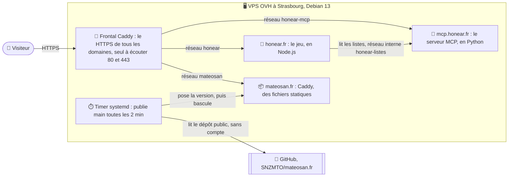

# Le serveur aujourd'hui (octobre 2026)

> Le serveur a été réinstallé le 12 octobre 2026, pour héberger plusieurs sites. Les autres journaux de `docs/` racontent la
> première installation, en juillet ; cette page dit ce qui tourne aujourd'hui. La configuration de la machine vit dans un
> dépôt privé, parce qu'elle donne l'adresse du serveur : ici, l'essentiel, sans secret.

## Le schéma



Chaque site a son réseau Docker, que le frontal rejoint : un site ne voit pas les autres. Le jeu et son MCP partagent en plus un
réseau interne, d'où l'on ne sort pas vers internet : le jeu y lit les playlists que le MCP enregistre.

## Ce qui protège la machine

- **SSH** : par clé seulement, pour un seul compte d'administration (`AllowUsers`), ni `root` ni mot de passe, trois essais par
  connexion. La configuration est dans un fichier à part, que `cloud-init` ne réécrit pas. fail2ban surveille les connexions.
- **Le pare-feu** (`ufw`) : tout est refusé en entrée, sauf SSH, HTTP et HTTPS (aussi en UDP, pour HTTP/3).
- **Docker et ufw** : Docker ouvre lui-même, sans passer par ufw, les ports qu'un conteneur publie. C'est pourquoi un seul
  conteneur en publie, le frontal (80 et 443) : les sites n'écoutent que sur leur réseau, et aucun service ne peut s'exposer par
  erreur.
- **Les conteneurs** : aucun ne peut gagner de droits (`no-new-privileges`), et ils ne se parlent que sur leurs réseaux
  (`icc: false`). Chaque site tourne sans capacités Linux, en lecture seule, sous un utilisateur sans droits, avec une limite de
  mémoire et de processus.
- **Le noyau** : pas de routes imposées de l'extérieur, les adresses source vérifiées, les SYN floods amortis.
- **Les mises à jour** : `unattended-upgrades` installe celles de Debian (la sécurité, et les versions de maintenance de la
  stable) et celles de Docker. Quand un noyau neuf le demande, la machine redémarre à 5 h, quand personne ne joue.
- **Les journaux** : ceux des conteneurs vont dans le journal de la machine, gardé six mois et 500 Mo au plus. Caddy n'y écrit
  que ses erreurs : aucune visite n'est notée.
- **Les domaines** : un enregistrement CAA qui n'autorise que Let's Encrypt à leur délivrer un certificat ; SPF, DKIM et DMARC
  pour le courrier ; DNSSEC sur mateosan.fr.

## La mise en ligne

- **mateosan.fr se publie seul.** Toutes les deux minutes, un timer systemd lit le dernier commit de `main` sur GitHub, sans
  compte, puisque le dépôt est public. Il pose le dossier `site/` à côté de la version en ligne, puis bascule d'un coup ; les
  trois dernières versions restent. Il tourne sous un utilisateur qui n'écrit que là, et n'exécute rien de ce qu'il lit. Le
  détail est dans [SNZMTO/mateosan.fr](https://github.com/SNZMTO/mateosan.fr), dossier `deploiement/`.
- **Honear et son MCP se mettent en ligne à la main**, depuis leur dépôt sur le serveur, quand personne ne joue : un script
  construit l'image et relance le conteneur.

## Les secrets

Aucun secret de déploiement : le timer lit un dépôt public. La machine ne garde que deux secrets, dans aucun dépôt : le mot de
passe de la boîte qui envoie les liens de connexion de Honear, et une clé d'accès aux statistiques du MCP. S'y ajoutent, tant
que des sessions de Claude Code travaillent sur le serveur, leurs propres jetons : voir la section suivante.

## L'agent IA sur le serveur

Un modèle de menace, écrit le 19 octobre 2026 : ce qui tourne aujourd'hui, ce que ça expose, ce qui doit changer, et comment.
**À appliquer, pas encore fait** : rien de la cible ni de la procédure n'est en place sur le serveur.

### Aujourd'hui

Des sessions de Claude Code travaillent sur le serveur même, avec `sudo`. Leurs consignes le disent :

- **Honear** ([SNZMTO/honear](https://github.com/SNZMTO/honear)) : « Les tests et la construction tournent sur la machine du
  jeu en ligne » (`CLAUDE.md:47`) ; la mise en ligne, c'est `sudo sh deploiement/mettre-en-ligne.sh` (`CLAUDE.md:55`).
- **mateosan.fr**,
  [`CLAUDE.md:40-49`](https://github.com/SNZMTO/mateosan.fr/blob/2d1cee82a99b5c01cb2e287dd0aebc200bc4c09c/CLAUDE.md#L40-L49) :
  `sudo sh deploiement/mettre-en-ligne.sh`, une session qui en commande une autre (`SendMessage`), le banc d'essai sur les
  deux cœurs du jeu, `sh ~/vps/depots/synchroniser.sh` au début de chaque tour et la branche poussée à la fin ; et
  [`banc/lancer.sh:16`](https://github.com/SNZMTO/mateosan.fr/blob/2d1cee82a99b5c01cb2e287dd0aebc200bc4c09c/banc/lancer.sh#L16) :
  `exec sudo -n docker run …`, qui ne marche que si `sudo` ne demande aucun mot de passe.

### Ce que ça expose

- **L'injection de prompt.** L'agent lit des données que n'importe qui écrit : les titres et les noms de playlists venus de
  Deezer (le jeu prend toute playlist publique), les recherches et les pseudos des joueurs, les listes que les assistants des
  autres enregistrent par le MCP, et tout ce qui les reprend (la base du jeu, un journal, une sortie de test). Une phrase
  adressée à l'agent, glissée dans l'une d'elles, peut le faire agir, avec ses droits ; et, par `SendMessage`, passer d'une
  session à l'autre.
- **`sudo` ou le groupe `docker`, c'est root.** `sudo -n docker run -v /:/hote …` monte toute la machine, et le groupe
  `docker` revient au même ([phases 2 et 3](phase2-3-docker-deploiement-https.md)). `sudo sh deploiement/mettre-en-ligne.sh`
  lance en root un script que l'agent peut modifier lui-même, dans son clone. Une injection réussie, c'est la machine
  entière : les trois sites et les comptes des joueurs.
- **Les secrets présents sur la machine.** Le mot de passe de la boîte d'envoi, la clé des statistiques du MCP, les adresses
  e-mail des joueurs ; et ceux des sessions elles-mêmes : le jeton de Claude Code, et de quoi pousser vers GitHub. Avec root,
  tout se lit ; et un accès à GitHub volé publie sur ce serveur ([phase 4](phase4-cicd-deploiement-auto.md)).

### La cible

- **Un compte dédié, `agent`, sans `sudo` ni groupe `docker`** : il écrit dans ses clones et lance les tests, rien d'autre ;
  il ne lit ni les secrets ni les données des joueurs.
- **Un seul geste en root, fixe** : sudoers ne lui ouvre qu'un script possédé par root, sans argument, qui ne lance rien de ce
  que l'agent peut écrire. Ce script tire `main` dans un clone à root, et n'en exécute la mise en ligne que si le dernier
  commit est signé par Mateo.
- **Le développement hors de la machine de production** : les sessions travaillent sur le PC de Mateo, et le banc d'essai
  ailleurs que sur les cœurs du jeu (sur ce PC, ou en CI).
- **Le déploiement depuis la CI** : la mise en ligne ne part plus d'une session, mais de GitHub Actions, une fois les tests et
  le banc verts sur un `main` signé. Le serveur n'ouvre rien pour autant : la CI désigne le commit à poser (une branche qu'elle
  seule avance), et le serveur le tire et vérifie sa signature, comme l'enveloppe ci-dessous. Cette étape n'est pas encore
  écrite.

### La procédure (à appliquer, pas encore fait)

**1. Signer `main`**, sur le PC de Mateo, une fois. Sans signature, l'enveloppe de l'étape 3 refuse tout.

```sh
ssh-keygen -t ed25519 -f ~/.ssh/signature_git -C "signature des commits"
git config --global gpg.format ssh
git config --global user.signingkey ~/.ssh/signature_git.pub
git config --global commit.gpgsign true
# Une branche de l'agent entre dans main par une fusion signée, faite en local ; jamais par le bouton de github.com, dont
# le commit porte la signature de GitHub.
git switch main && git merge --no-ff une-branche && git push origin main
```

**2. Le compte `agent`**, sur le serveur. `AllowUsers` n'admet toujours que le compte d'administration : `agent` n'a pas de
SSH, les sessions s'y ouvrent depuis ce compte-là.

```sh
sudo useradd --create-home --shell /bin/bash --comment "Claude Code, sans sudo ni docker" agent
id agent             # uid=…(agent) gid=…(agent) groupes=…(agent) : ni sudo, ni docker
sudo -iu agent       # les sessions de Claude Code se lancent d'ici, dans les clones de ce compte
```

**3. Le script enveloppe**, [`outils/agent/honear-mettre-en-ligne.sh`](../outils/agent/honear-mettre-en-ligne.sh), posé
depuis un clone de ce dépôt. Il tire `main` dans `/var/lib/honear-mise-en-ligne`, à root, vérifie la signature et refuse un
`main` qui recule, puis lance la mise en ligne de ce clone-là, jamais de celui de l'agent.

```sh
sudo install -o root -g root -m 0755 outils/agent/honear-mettre-en-ligne.sh /usr/local/sbin/honear-mettre-en-ligne
sudo install -d -o root -g root -m 0700 /var/lib/honear-mise-en-ligne
sudo install -d -o root -g root -m 0755 /etc/honear-mise-en-ligne
# La clé publique de l'étape 1 (signature_git.pub, copiée sur le serveur), au format des signataires de ssh-keygen.
printf '%s namespaces="git" %s\n' 221996800+SNZMTO@users.noreply.github.com "$(cat signature_git.pub)" |
  sudo tee /etc/honear-mise-en-ligne/signataires >/dev/null
```

**4. Le sudoers**, posé avec `visudo`, qui refuse d'enregistrer un fichier faux :

```sh
sudo visudo -f /etc/sudoers.d/agent
```

```
# Le compte agent ne lance en root que la mise en ligne de Honear, et sans argument : c'est ce que dit "".
agent ALL=(root) NOPASSWD: /usr/local/sbin/honear-mettre-en-ligne ""
```

Sans le `""`, `sudo` accepterait n'importe quels arguments. Le nom du fichier n'a pas de point : `sudo` ignore les fichiers de
`/etc/sudoers.d` qui en ont un.

**5. Vérifier, sous le compte `agent`.**

```sh
sudo -l -U agent                                    # une seule règle : honear-mettre-en-ligne ""
sudo -iu agent
sudo -n true                                        # refusé
docker ps                                           # refusé : pas de groupe docker
sudo -n /usr/local/sbin/honear-mettre-en-ligne x    # refusé : un argument
sudo -n /usr/local/sbin/honear-mettre-en-ligne      # la mise en ligne, si le dernier commit de main est signé
```

**6. Quitter l'ancien compte.** Les sessions ne tournent plus sous le compte d'administration. Si `sudo` y est sans mot de passe
(ce que `sudo -n` suppose), toute session qui y reviendrait serait root : lui donner un mot de passe (`sudo passwd` suivi du
nom du compte), vérifier dans une deuxième connexion SSH que `sudo -k; sudo true` le demande et l'accepte, et seulement
ensuite retirer la règle `NOPASSWD` de `/etc/sudoers.d/`. Dans l'autre ordre, on perd `sudo`.

**À vérifier en l'appliquant.** Que `deploiement/mettre-en-ligne.sh` de Honear ne lise rien d'autre que son clone et ses
secrets hors dépôt, et ne tire rien lui-même : l'enveloppe le lance sur un commit détaché. Que les fichiers des secrets et les
dossiers des données refusent `agent` (`sudo -u agent cat` doit échouer). Le MCP suit le même modèle : une deuxième
enveloppe, une deuxième règle.

## Ce qui reste à faire

- **Les sauvegardes, d'abord.** Les comptes des joueurs de Honear (leurs adresses e-mail et leurs scores) ne sont encore
  sauvegardés nulle part ailleurs que sur le serveur. La procédure est prête, pas encore installée : restic, chaque nuit,
  chiffré et hors du serveur, avec un test de restauration daté ([sauvegardes.md](sauvegardes.md)). Puis les certificats et
  la configuration.
- **Sortir l'agent IA de root.** La procédure est prête ([L'agent IA sur le serveur](#lagent-ia-sur-le-serveur)), pas encore
  appliquée.
- La supervision (Prometheus, Grafana), une configuration rejouable (Ansible), l'infrastructure décrite par du code
  (Terraform).
