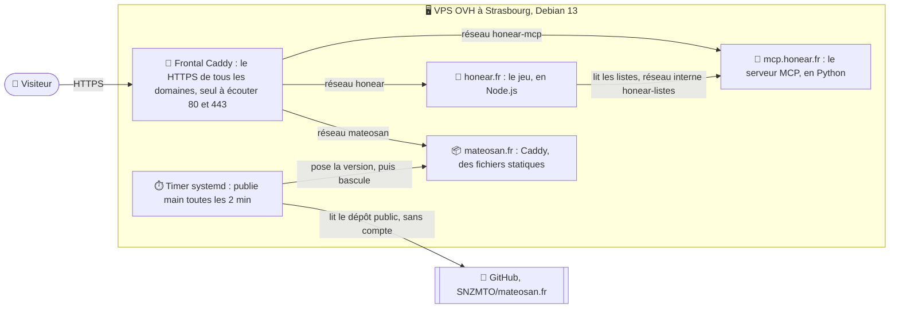

# Le serveur aujourd'hui (octobre 2026)

> Le serveur a été réinstallé le 12 octobre 2026, pour héberger plusieurs sites. Les autres journaux de `docs/` racontent la
> première installation, en juillet ; cette page dit ce qui tourne aujourd'hui. La configuration de la machine vit dans un
> dépôt privé, parce qu'elle donne l'adresse du serveur : ici, l'essentiel, sans secret.

## Le schéma

Chaque site a son réseau Docker, que le frontal rejoint : un site ne voit pas les autres. Le jeu et son MCP partagent en plus un
réseau interne, d'où l'on ne sort pas vers internet : le jeu y lit les playlists que le MCP enregistre.

## Ce qui protège la machine

- **SSH** : par clé seulement, pour un seul compte d'administration (`AllowUsers`), ni `root` ni mot de passe, trois essais par
  connexion. La configuration est dans un fichier à part, que `cloud-init` ne réécrit pas. fail2ban surveille les connexions.
- **Le pare-feu** (`ufw`) : tout est refusé en entrée, sauf SSH, HTTP et HTTPS (aussi en UDP, pour HTTP/3).
- **Docker et ufw** : Docker ouvre lui-même, sans passer par ufw, les ports qu'un conteneur publie. C'est pourquoi un seul
  conteneur en publie, le frontal (80 et 443) : les sites n'écoutent que sur leur réseau, et aucun service ne peut s'exposer par
  erreur.
- **Les conteneurs** : aucun ne peut gagner de droits (`no-new-privileges`), et ils ne se parlent que sur leurs réseaux
  (`icc: false`). Chaque site tourne sans capacités Linux, en lecture seule, sous un utilisateur sans droits, avec une limite de
  mémoire et de processus.
- **Le noyau** : pas de routes imposées de l'extérieur, les adresses source vérifiées, les SYN floods amortis.
- **Les mises à jour** : `unattended-upgrades` installe celles de Debian (la sécurité, et les versions de maintenance de la
  stable) et celles de Docker. Quand un noyau neuf le demande, la machine redémarre à 5 h, quand personne ne joue.
- **Les journaux** : ceux des conteneurs vont dans le journal de la machine, gardé six mois et 500 Mo au plus. Caddy n'y écrit
  que ses erreurs : aucune visite n'est notée.
- **Les domaines** : un enregistrement CAA qui n'autorise que Let's Encrypt à leur délivrer un certificat ; SPF, DKIM et DMARC
  pour le courrier ; DNSSEC sur mateosan.fr.

## La mise en ligne

- **mateosan.fr se publie seul.** Toutes les deux minutes, un timer systemd lit le dernier commit de `main` sur GitHub, sans
  compte, puisque le dépôt est public. Il pose le dossier `site/` à côté de la version en ligne, puis bascule d'un coup ; les
  trois dernières versions restent. Il tourne sous un utilisateur qui n'écrit que là, et n'exécute rien de ce qu'il lit. Le
  détail est dans [SNZMTO/mateosan.fr](https://github.com/SNZMTO/mateosan.fr), dossier `deploiement/`.
- **Honear et son MCP se mettent en ligne à la main**, depuis leur dépôt sur le serveur, quand personne ne joue : un script
  construit l'image et relance le conteneur.

## Les secrets

Aucun secret de déploiement : le timer lit un dépôt public. La machine ne garde que deux secrets, dans aucun dépôt : le mot de
passe de la boîte qui envoie les liens de connexion de Honear, et une clé d'accès aux statistiques du MCP.

## Ce qui reste à faire

- **Les sauvegardes, d'abord.** Les comptes des joueurs de Honear (leurs adresses e-mail et leurs scores) ne sont encore
  sauvegardés nulle part ailleurs que sur le serveur. Puis les certificats et la configuration.
- La supervision (Prometheus, Grafana), une configuration rejouable (Ansible), l'infrastructure décrite par du code
  (Terraform).
